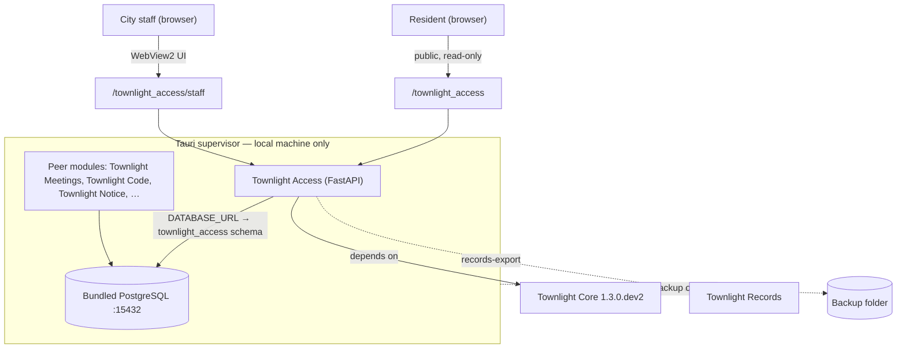

<a id="townlight_access"></a>

# Townlight Access

## Windows staff workflow — 0.5.0 candidate

This candidate is prepared; exact signed-installer acceptance is pending. It supports a fresh profile only. Keep the previous release with any existing unmarked profile. The compatibility profile directory remains `%LOCALAPPDATA%\CivicSuite`; the new program refuses to adopt existing unmarked city data.

1. Sign in with an account allowed to use Access and enable the Access capability. Open Accessibility and enter the actual source title, text, language and image-description information.
2. Save the review. Reopen it to inspect the source, deterministic findings and any saved local-model advice, model identity and outcome. Advice is not a certified accessibility finding or approval.
3. For plain-language or translation work, enter the actual source and request a draft. The Windows path uses the suite's configured local model. Saved drafts retain source/output, language, model/outcome, staff actor/time and the requirement for qualified human review. An unavailable-model sample is labeled as a sample; it is not a translation of the input.
4. Reopen saved drafts from Access, including after restarting the app. Select Export record on the desired review or draft. The desktop writes a Markdown record and verifies its content hash and companion manifest before reporting completion. The fenced JSON is the complete record, including source, output/advice and relevant provenance; ordinary HTML rendering is unnecessary to read it.
5. To hand the record to Records, open the intended Records request, attach the actual exported Markdown file using Records' native file picker, and read it back from that request. A successful Access export alone does not attach evidence to a request or authorize disclosure. Records permissions and review/release rules still apply.

The complete review export includes reviewed source, findings, saved advice/model/outcome where available, actor/time, relevant audit history and advisory limits. Draft exports include the retained source/output pair and review status. Back up the complete profile using System Health and restore only a matching new-format backup. Preservation of these additions on the actual installed candidate remains part of acceptance.

No automated result certifies ADA compliance, creates an accessible/tagged PDF, approves publication or replaces a qualified translator or ADA coordinator.

## Standalone support service

The separately run FastAPI service provides deterministic checks and planning helpers. Its Spanish and Vietnamese responses are fixed samples, **not translations of the supplied source**. Its deterministic jargon substitutions are separate from the Windows model workflow. A shared write token proves possession of that token; it does not establish an individual staff identity. Standalone audit records use `shared-token-staff` for that reason.

Standalone saved-review exports now return a complete Markdown artifact with source, findings and relevant audit provenance, plus its SHA-256. The staff page offers that actual artifact for download. Other form, tagged-PDF, ADA and publishing helpers remain checklists. The standalone service does not acquire Windows draft persistence or native individual-account identity merely because it shares this package.


Townlight Access is the Townlight module for accessibility, plain-language, multilingual, and ADA Title II review-support workflows.

> **v0.5.0 · prepared candidate; installed acceptance pending.** Townlight Access does **not** give legal advice, certify ADA compliance, issue official translations, or publish anything on its own — your staff, ADA coordinator, translators, and legal counsel always make the final call.

This README has two audiences:

- **Civic staff (clerks, communicators, ADA coordinators)** — see the [User Manual, Part 1](USER-MANUAL.md#part-1--for-civic-staff) or the [landing page](docs/index.html). Short version below.
- **IT & technical staff** — architecture, API, persistence, and security are below.

---

## For civic staff (the short version)

Townlight Access helps your office put out public notices everyone can read — and keep a record proving you checked.

- Paste a draft into the **public checker** to get instant, plain-language fixes. Nothing is saved — it's a safe place to try things.
- To keep a review **on the record**, save it in the **staff workspace** and export a copy you can hand to a public-records request.
- The Windows model path drafts text for qualified review; standalone helpers substitute jargon, show fixed language samples, and prepare ADA Title II review checklists — but never publishes anything on its own.

Full walkthrough: [User Manual, Part 1](USER-MANUAL.md#part-1--for-civic-staff).

---

## For IT & technical staff

The standalone support service is a deterministic FastAPI module (Python), pinned to the coordinated Townlight Core 1.3.0.dev2 wheel — no model/LLM calls and no outbound network calls, so output is reproducible.

### Architecture

In Townlight Windows Local, a Tauri supervisor runs Townlight Access (and peer modules) against a bundled PostgreSQL on `127.0.0.1:15432`; Townlight Access uses a dedicated `townlight_access` schema. The supervisor's backup captures the whole data directory, so module data rides along.



### What it provides

- A **stateless public accessibility checker** (`/townlight_access`) that flags WCAG-aligned issues with actionable, standard-referenced fixes — no persistence, no token.
- A **token-guarded staff workspace** (`/townlight_access/staff`) for saving reviews and building records-ready exports.
- Plain-language rewrites that preserve source/rewrite provenance.
- Fixed standalone multilingual samples, explicitly not translations; Windows local-model drafts require qualified review.
- ADA Title II review-support checklists (without claiming certification).
- Accessible-form and tagged-PDF expectation checks, and a staff publication workflow.
- A persisted **audit trail** of every write/export, and integration contracts for downstream publishers.

### Runtime API

| Method & path | Auth | Persists? | Purpose |
|---|---|---|---|
| `GET /` · `GET /health` | — | no | Status, boundaries, versions |
| `GET /ready` · `GET /api/v1/townlight_access/readiness` | — | no | Persistence readiness gate |
| `GET /townlight_access` · `GET /townlight_access/staff` | — | no | Public checker / staff workspace (UI) |
| `POST /api/v1/townlight_access/analyze` | — | no | Stateless accessibility analysis |
| `POST /api/v1/townlight_access/review` | **token** | **yes** | Save a review record (+ audit) |
| `GET /api/v1/townlight_access/reviews` · `GET …/reviews/{id}` | — | no | List / retrieve saved reviews |
| `POST /api/v1/townlight_access/reviews/{id}/records-export` | **token** | **yes** (audit) | Records-ready export (+ audit) |
| `GET /api/v1/townlight_access/integration-contracts` | — | no | Published integration contracts |
| `POST /api/v1/townlight_access/plain-language` · `…/language-variant` | — | no | Plain-language rewrite / multilingual draft |
| `POST /api/v1/townlight_access/forms` · `…/publishing-workflow` | — | no | Accessible-form checks / publication workflow |
| `POST /api/v1/townlight_access/ada-title-ii` · `…/tagged-pdf` · `…/export` | — | no | ADA Title II checklist / tagged-PDF / export checklist |

Token-guarded writes require `X-Townlight-Access-Write-Token` matching `TOWNLIGHT_ACCESS_TRUSTED_WRITE_TOKEN` (constant-time compare): missing/invalid → `403`, guard not configured → `503`. The token is never embedded in served HTML — the staff page provides a field where an operator pastes it.

### Persistence & configuration

| Variable | Purpose |
|---|---|
| `DATABASE_URL` | Shared Townlight Core PostgreSQL (supervisor-injected) — the production default |
| `TOWNLIGHT_ACCESS_REVIEW_DB_URL` | Explicit SQLAlchemy URL override |
| `TOWNLIGHT_ACCESS_DATA_DIR` | Directory for the SQLite dev fallback (`data/townlight_access-reviews.db`) |
| `TOWNLIGHT_ACCESS_TRUSTED_WRITE_TOKEN` | **Required** server secret for persistent writes |

Resolution order: `TOWNLIGHT_ACCESS_REVIEW_DB_URL` → `DATABASE_URL` (converted to a sync psycopg2 URL) → SQLite dev fallback. Use the `townlight_access-db-status` console script with an explicit URL to preflight a database.

### Security

Persistence-write routes require the trusted-write token (constant-time compare, fails closed); read and stateless-analysis routes are open. Every write/export persists an `audit_events` row; `review.create`'s audit is committed atomically with the record. No model/LLM or outbound network calls. Review + audit data live in the shared Postgres cluster and are captured by the supervisor's wholesale `Data/` backup. See [SECURITY.md](SECURITY.md).

### Developer quickstart

```powershell
python -m venv .venv
.\.venv\Scripts\Activate.ps1
# Set TOWNLIGHT_CORE_WHEEL to the exact candidate Core wheel first.
python -m pip install "$env:TOWNLIGHT_CORE_WHEEL"
python -m pip install -e ".[dev]"
python -m pytest -q
# Full release gate (requires a real PostgreSQL):
$env:TOWNLIGHT_ACCESS_POSTGRES_TEST_URL = "postgresql+psycopg2://USER:PW@HOST:PORT/DB"
bash scripts/verify-release.sh
```

### Integration

Townlight Access **depends on Townlight Core** (Townlight Core does not depend on Townlight Access). It publishes contracts at `/api/v1/townlight_access/integration-contracts`, hands records exports to **Townlight Records**, and supports the kept downstream Zoning, Planning, Permitting and Inspections consumers.

### Release status

`0.5.0` is the prepared naming and provenance candidate. Its exact signed Windows installed acceptance, authorization, restart and backup/restore evidence remains pending. Earlier probe records describe their original artifacts and do not prove this candidate complete. The earlier `v1.0.0` release was published in error; its original record remains [historical evidence](docs/release-integrity-correction-2026-05-21.md).

## Prepared package installation

The renamed distributions are not yet published on a package index. Use the
matching verified candidate wheel directory, not a renamed historical release
URL. Installation of these Python packages is a developer/package check;
the signed Windows MSI and its installed acceptance remain separate.

In a new Windows virtual environment, replace the example wheel-directory path
with the directory accompanying this candidate and verify its SHA256 manifest:

```powershell
python -m venv .venv
.\.venv\Scripts\Activate.ps1
$candidateWheels = (Resolve-Path 'C:\path\to\candidate-wheels').Path
python -m pip install (Join-Path $candidateWheels 'townlight_core-1.3.0.dev2-py3-none-any.whl')
python -m pip install (Join-Path $candidateWheels 'townlight_access-0.5.0-py3-none-any.whl')
python -c "import townlight_access; from importlib.metadata import version; print(version('townlight-access'))"
```

Expected principal import: `townlight_access`; expected distribution version:
`0.5.0`. Use a fresh empty database/profile for workflow testing. Existing
city data and the previous release remain untouched; no in-place upgrade or
old-import compatibility shim is supplied.

## License

Code: AGPL-3.0-only. See [LICENSE](LICENSE); historical grants are retained under docs/licensing/history.
Documentation is CC BY 4.0.

Current owned candidate code: AGPL-3.0-only, without additional permissions. Historical grants retained under docs/licensing/history.
